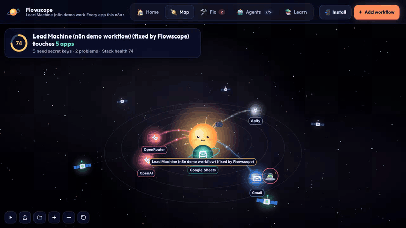
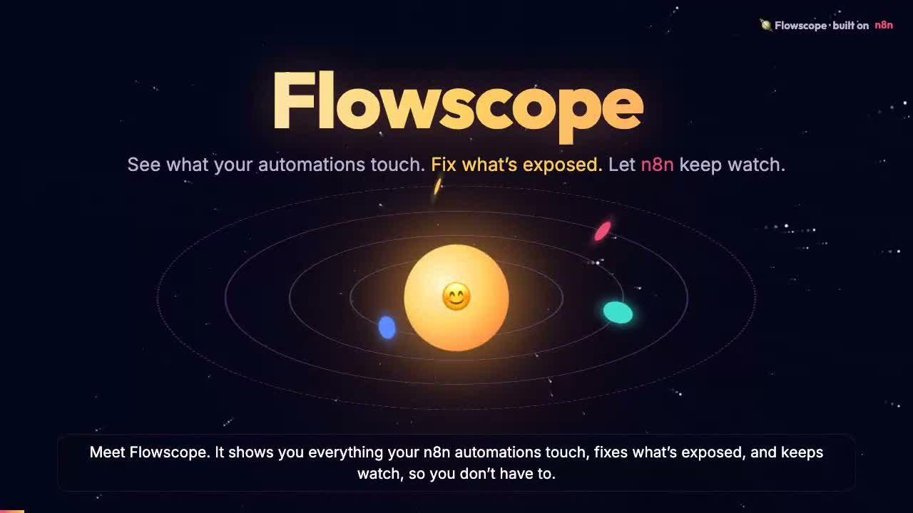
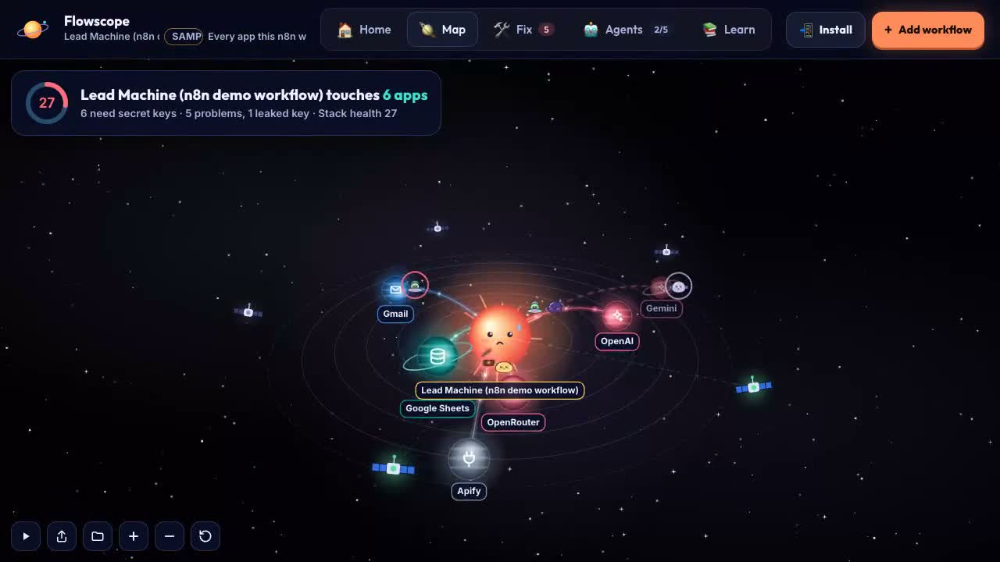
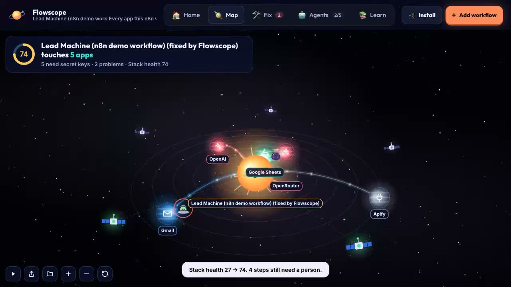
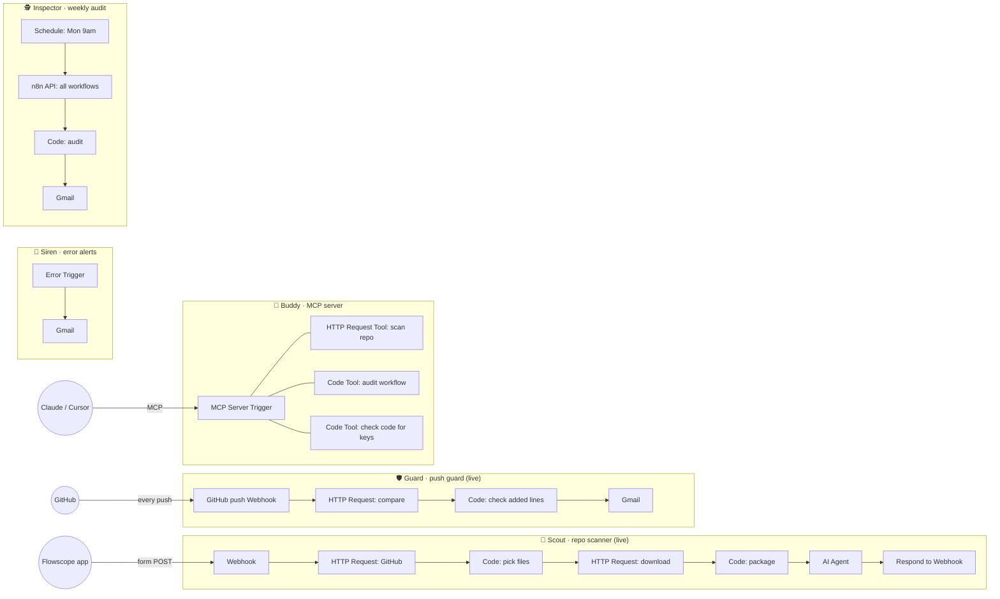
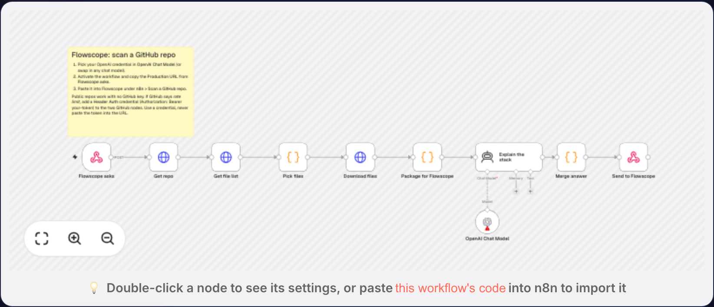
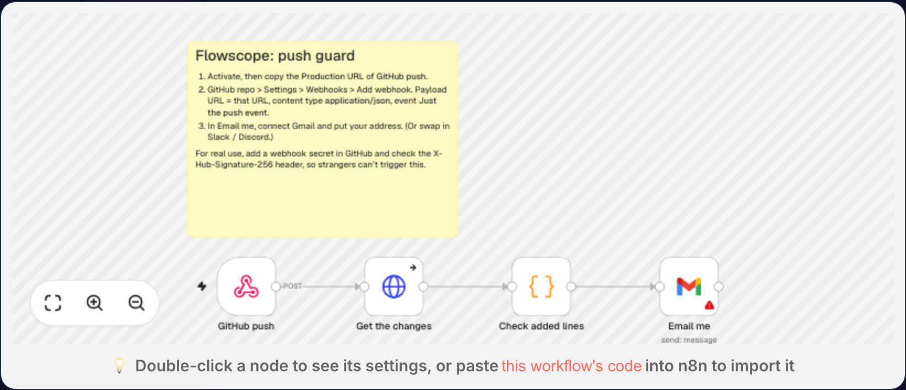
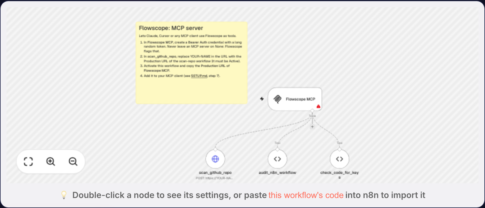
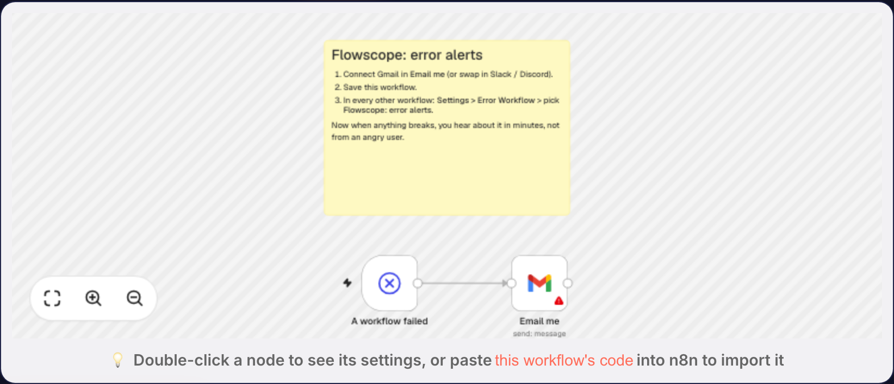
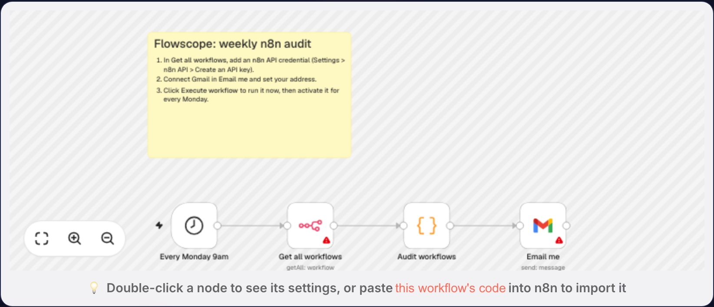

# 🪐 Flowscope

### ▶️ Live app: **[arushish5-cyber.github.io/flowscope](https://arushish5-cyber.github.io/flowscope/)**

**See every app your n8n automations touch as a 3D solar system, fix what's exposed in one click, and let n8n agents keep watch.**

  

 <b>🎬 <a href="media/flowscope-film.mp4">Watch the 2-minute film</a></b>: the problem, the idea, how it’s built, all 5 n8n workflows, and why it’s different · <a href="media/flowscope-demo.mp4">60-second app demo</a>

| 😟 Before: an Apify key is typed into a node (health 27) | 😄 After the 🪄 Fixer (health 74) |
|---|---|
|  |  |

### ✅ How we know it’s really fixed
The Fix tab re-runs the same checks on the **fixed workflow’s JSON** and shows real counts, not a guess:

| Check | Before | After |
|---|---|---|
| API keys typed into nodes | 1 | **0** ✅ |
| Webhooks anyone can call | 1 | **0** ✅ |
| Turned-off nodes left behind | 1 | **0** ✅ |
| Alerts when it breaks | off | off 👤 needs you |

Paste the fixed copy into n8n and the key is gone from the workflow. You still make a new key, because the old one was already shared.

Built at the **n8n Santa Clara University Buildathon** (Nov 15, 2026). 🔗 **[Live app](https://arushish5-cyber.github.io/flowscope/)** · **[n8n instance](https://flowscope.app.n8n.cloud)** (sign-in needed) · **[Workflow files](workflows)** · **[Film](media/flowscope-film.mp4)**

---

**Try it in 60 seconds:**
1. Open the **[live app](https://arushish5-cyber.github.io/flowscope/)**. **🏠 Home** explains every tab.
2. Press **🪐 See this morning's n8n demo workflow**: the Lead Machine (Apify, Gemini, OpenRouter, Sheets, Gmail). The sun looks worried because an Apify key is typed into a node.
3. Open **🛠️ Fix**, then **See it on the map**, and health goes **27 → 74**.
4. On Home, under **Try a real project**, press **🐔 The Coop**. Our n8n reads the real repo and an AI Agent explains it live.
5. Click empty space for shooting stars ✨.

---

## ⚙️ How Flowscope uses n8n

Every agent is a real n8n workflow. These are the actual node chains:

| Agent | n8n nodes | Status |
|---|---|---|
| 🔭 **Scout** | Webhook, HTTP Request, Code, **AI Agent** (n8n Gateway credits), Respond to Webhook | ✅ Live, called by the app |
| 🛡️ **Guard** | Webhook, HTTP Request, Code, Gmail | ✅ Live on the `flowscope` and `gitup` repos (email step on once Gmail is connected) |
| 🤖 **Buddy** | **MCP Server Trigger**, HTTP Request Tool, Code Tool ×2 | Imported, needs a Bearer token |
| 🚨 **Siren** | Error Trigger, Gmail | Imported, needs Gmail |
| 🕵️ **Inspector** | Schedule Trigger, n8n API, Code, Gmail | Imported, needs an n8n API key |
| 🪄 **Fixer** | Runs in the app; its output is a repaired n8n workflow you paste back | ✅ Works |

The same rules also run as **Flowscope lint**: a CLI, a pre-commit hook and a GitHub Action (`.github/workflows/flowscope-lint.yml`). In our test, three layers caught the fake key: Guard in n8n, the lint Action, and GitHub's own push protection.

---

## 🖼️ The real workflows in n8n

These are drawn by n8n's own canvas from the files in [`workflows/`](workflows). You can see them live in the app too: **Home → ❤️ How n8n powers it → 🔍 Look inside n8n** (no sign-in needed). A red ⚠ on a node only means "connect your own credential here". No keys are stored in these files.

**🔭 Scout: scan a GitHub repo** · Webhook → GitHub API → pick and download files → **AI Agent** explains the stack → Respond to Webhook

**🛡️ Guard: push guard** · every `git push` → get the changes → check added lines for keys → email you

**🤖 Buddy: MCP server** · Claude, Cursor or any MCP client can call Flowscope as tools

<b>🚨 Siren</b> (error alerts) and <b>🕵️ Inspector</b> (weekly audit)

---

## 🧠 The brain, the heart, and the face

| Part | What it is | Why it's built this way |
|---|---|---|
| 🧠 **Brain** | A rule engine in the page (`flowscope.html`): it reads n8n workflow JSON or code, finds every app, scores health, spots hazards, and the 🪄 Fixer writes the repaired workflow. | Rules, not AI, so it's **instant, free, private** (nothing uploaded) and gives **the same answer every time**. |
| ❤️ **Heart** | **n8n**: 5 workflows that talk to the outside world (GitHub, the AI Agent node, Gmail, schedules, MCP). | No server of our own. n8n runs the agents 24/7 and does the AI part. |
| 🪐 **Face** | The 3D solar system, plain-English fixes and the cute characters. | Beginners understand a picture faster than a report. |

## 🤔 Why not just ask Claude (or any AI agent)?

We use AI too: Scout's **AI Agent** node, and Buddy lets Claude or Cursor **call Flowscope**. They work together. But a chat alone falls short:

| | Asking an AI chat | Flowscope |
|---|---|---|
| When it runs | Only when you remember to ask | **Every push, every failure, every Monday**, by itself in n8n |
| Same input, same answer? | Not always | **Yes**: rules, plus a health score you can track |
| Your keys | You paste the workflow (keys and all) into a chat | Checked **in your browser**; we report line numbers, never key values |
| Output | Advice to copy by hand | A **fixed n8n workflow** to paste straight back |
| Seeing it | A wall of text | A **map** of everything your automation touches |

**One line:** *Claude is who you ask. Flowscope is who's watching.*

## 🧑‍💻 For vibe coders and students too

Everyone has projects running that they forget, some with live keys inside.
- **🛰️ Your projects, checked on for you** (Home): add your GitHub repos, see which are 🟢 alive, 🟡 getting quiet or 🔴 forgotten, and scan any of them with n8n.
- **Code, not just workflows:** the lint and Guard catch keys in code; the map works on a project folder too.
- **Teach your AI:** one click gives you a rule for `AGENTS.md` / `CLAUDE.md` so Cursor and Claude Code stop repeating the mistake.
- **Buddy (MCP):** ask Claude or Cursor "scan my repo" and it calls Flowscope through n8n.

---

## 📲 Install it as an app
- **Laptop (Chrome or Edge):** click **📲 Install** at the top right.
- **iPhone:** in Safari, tap **Share**, then **Add to Home Screen**.
- **Android:** in Chrome, tap **Install app**.

It opens full screen, has its own icon, and works offline.

## What's inside
| Path | What it is |
|---|---|
| `flowscope.html` | The app. One file, no build step, and nothing you paste leaves the browser. |
| `workflows/` | The 5 n8n workflows. Import any of them with n8n's **Import from URL**, or copy from the app's **🤖 Agents** tab with your email filled in. |
| `manifest.webmanifest`, `sw.js`, `icons/` | What makes it an installable, offline-capable app |
| `scripts/flowscope-lint.mjs` | The lint CLI used by the pre-commit hook and the GitHub Action |
| [`SETUP.md`](SETUP.md) | Step-by-step n8n setup and the 3-minute demo script |
| [`PITCH.md`](PITCH.md) | Competitors, why we win, and how it makes money |

## 💸 How it makes money
Free: map, fix and lint. **Pro (~$12/mo):** we run the watching agents for you. **Agency (~$79/mo):** branded security reports that n8n freelancers can bill their clients for. **Verified templates:** a "Flowscope checked" badge for people selling n8n templates.
