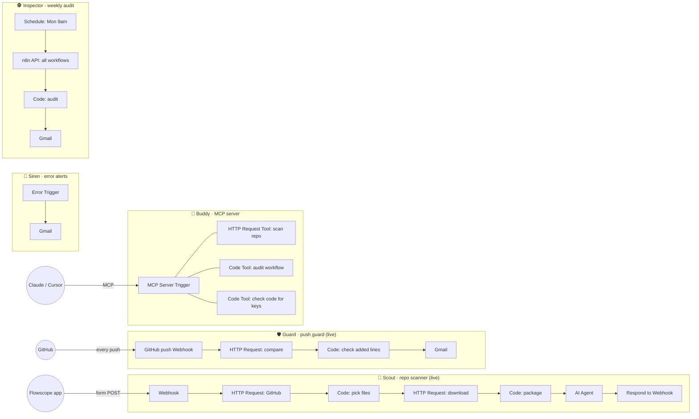

# 🪐 Flowscope

### ▶️ Live app: **https://arushish5-cyber.github.io/flowscope/**

**See every app your n8n automations touch as a 3D solar system, fix what's exposed in one click, and let n8n agents keep watch.**

  

<b>🎬 <a href="media/flowscope-demo.mp4">Watch the 60-second demo video</a></b> · the demo workflow, the leaked key, the one-click fix (27 → 74), the agents

| 😟 Before: an Apify key is typed into a node (health 27) | 😄 After the 🪄 Fixer (health 74) |
|---|---|
|  |  |

Built at the **n8n Santa Clara University Buildathon** (Nov 15, 2026).

---

## 🧑‍⚖️ For judges

| Judging criterion | What to look at |
|---|---|
| **Idea · Uniqueness** | n8n scanners already exist (`n8n audit`, FlowGuard, FlowSentry, RiskVoid, audit8n), and **all of them stop at a report**. Flowscope **hands back the fixed workflow**, explains it to beginners as a solar system, covers the code next to the workflow, and lives **inside n8n and your AI tool** (an MCP server). |
| **Implementation · Does it work?** | 5 real n8n workflows, **live** at `flowscope.app.n8n.cloud`. Tested today: Scout scanned real repos in 6 to 10 s; Guard caught a fake AWS key pushed to GitHub in 2.2 s; the Fixer takes this morning's n8n demo workflow from health **27 → 74**. |
| **Presentation · Clarity** | One picture: the sun is your project, planets are the apps it uses, and space hazards are the problems. Every fix is written in plain words, step by step, for n8n users. |

**Try it in 60 seconds:**
1. Open the **[live app](https://arushish5-cyber.github.io/flowscope/)**. **🏠 Home** explains every tab.
2. Press **🪐 See this morning's n8n demo workflow**: the Lead Machine (Apify, Gemini, OpenRouter, Sheets, Gmail). The sun looks worried because an Apify key is typed into a node.
3. Open **🛠️ Fix**, then **See it on the map**, and health goes **27 → 74**.
4. On Home, under **Try a real project**, press **🧗 GitUp**. Our n8n reads the real repo and an AI Agent explains it live.
5. Click empty space for shooting stars ✨.

---

## ⚙️ How Flowscope uses n8n

Every agent is a real n8n workflow. These are the actual node chains:

| Agent | n8n nodes | Status |
|---|---|---|
| 🔭 **Scout** | Webhook, HTTP Request, Code, **AI Agent** (n8n Gateway credits), Respond to Webhook | ✅ Live, called by the app |
| 🛡️ **Guard** | Webhook, HTTP Request, Code, Gmail | ✅ Live on the `flowscope` and `gitup` repos (email step on once Gmail is connected) |
| 🤖 **Buddy** | **MCP Server Trigger**, HTTP Request Tool, Code Tool ×2 | Imported, needs a Bearer token |
| 🚨 **Siren** | Error Trigger, Gmail | Imported, needs Gmail |
| 🕵️ **Inspector** | Schedule Trigger, n8n API, Code, Gmail | Imported, needs an n8n API key |
| 🪄 **Fixer** | Runs in the app; its output is a repaired n8n workflow you paste back | ✅ Works |

The same rules also run as **Flowscope lint**: a CLI, a pre-commit hook and a GitHub Action (`.github/workflows/flowscope-lint.yml`). In our test, three layers caught the fake key: Guard in n8n, the lint Action, and GitHub's own push protection.

---

## 📲 Install it as an app
- **Laptop (Chrome or Edge):** click **📲 Install** at the top right.
- **iPhone:** in Safari, tap **Share**, then **Add to Home Screen**.
- **Android:** in Chrome, tap **Install app**.

It opens full screen, has its own icon, and works offline.

## What's inside
| Path | What it is |
|---|---|
| `flowscope.html` | The app. One file, no build step, and nothing you paste leaves the browser. |
| `workflows/` | The 5 n8n workflows. Import any of them with n8n's **Import from URL**, or copy from the app's **🤖 Agents** tab with your email filled in. |
| `manifest.webmanifest`, `sw.js`, `icons/` | What makes it an installable, offline-capable app |
| `scripts/flowscope-lint.mjs` | The lint CLI used by the pre-commit hook and the GitHub Action |
| [`SETUP.md`](SETUP.md) | Step-by-step n8n setup and the 3-minute demo script |
| [`PITCH.md`](PITCH.md) | Competitors, why we win, and how it makes money |

## 💸 How it makes money
Free: map, fix and lint. **Pro (~$12/mo):** we run the watching agents for you. **Agency (~$79/mo):** branded security reports that n8n freelancers can bill their clients for. **Verified templates:** a "Flowscope checked" badge for people selling n8n templates.
